

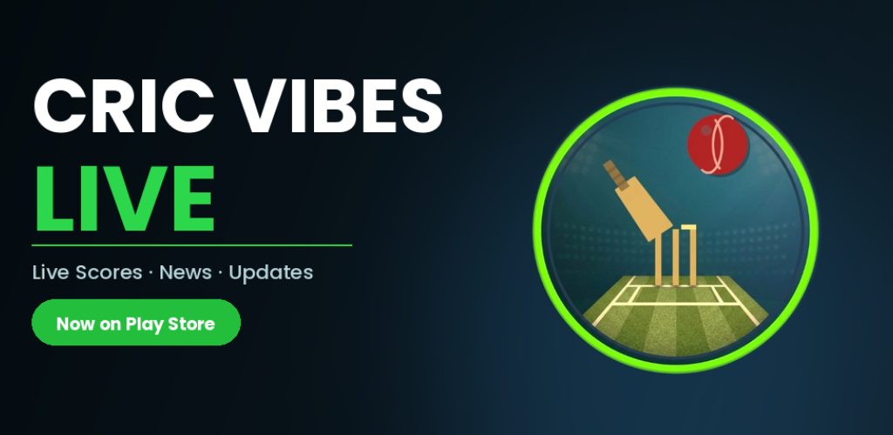

**Real-time cricket scores, ICC rankings, player stats, news, and much more — all in one place.**

## 📱 About The App

**Cric Vibes Live** is a feature-rich cricket app built with Flutter, offering both online and offline experiences for cricket fans worldwide. From live match scores to creating your own tournament — it has everything a cricket enthusiast needs.

Built as an independent project by a second-semester BS Computer Science student at PIEAS, this app is fully published and live on the Google Play Store under the **Niazi Tech** developer brand.

## ✨ Features

### 🔴 Online Features
| Feature | Description |
|---|---|
| 🏟️ **Live Scores** | Real-time scores for all international & domestic matches |
| 🏆 **ICC Rankings** | Latest player and team rankings across all formats |
| 🔍 **Player Search** | Search any cricketer — full biography + Test, ODI & T20 stats |
| 📰 **Cricket News** | Latest cricket news from around the globe |
| 📅 **Match Schedule** | Upcoming international events and match fixtures |
| ⚖️ **Player Comparison** | Compare any two players side by side across all formats |
| 🎬 **Match Highlights** | Fresh cricket highlight clips from official boards & leagues, updated in near real-time |
| 📊 **Cricket Analysis** | Interviews, expert commentary & match analysis from top cricket channels |

### 📴 Offline Features
| Feature | Description |
|---|---|
| 🏅 **Create Tournament** | Build your own tournament, create teams & add players manually |
| 📜 **World Records** | All-time cricket world records in one place |
| 📖 **Cricket Rules & Terms** | Complete guide to cricket rules and terminology |

## 🛠️ Tech Stack
| Technology | Usage |
|---|---|
| **Flutter & Dart** | Cross-platform UI development |
| **Firebase** | Authentication, Cloud Functions, Secret Manager |
| **Firestore** | Real-time database & user data storage |
| **REST API (RapidAPI)** | Live scores, rankings & player data |
| **YouTube Data API** | Match highlights & cricket analysis videos |
| **FCM** | Push notifications for match updates |
| **Git & GitHub** | Version control |
| **Android Studio** | Development environment |
| **Google Play Console** | App deployment & distribution |

## 📸 Screenshots

<table>
<tr>
<td align="center" width="33%">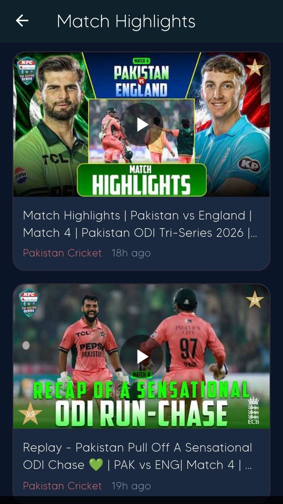 <b>Match Highlights</b></td>
<td align="center" width="33%">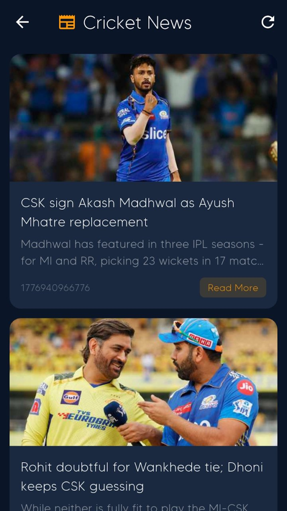 <b>Cricket News</b></td>
<td align="center" width="33%">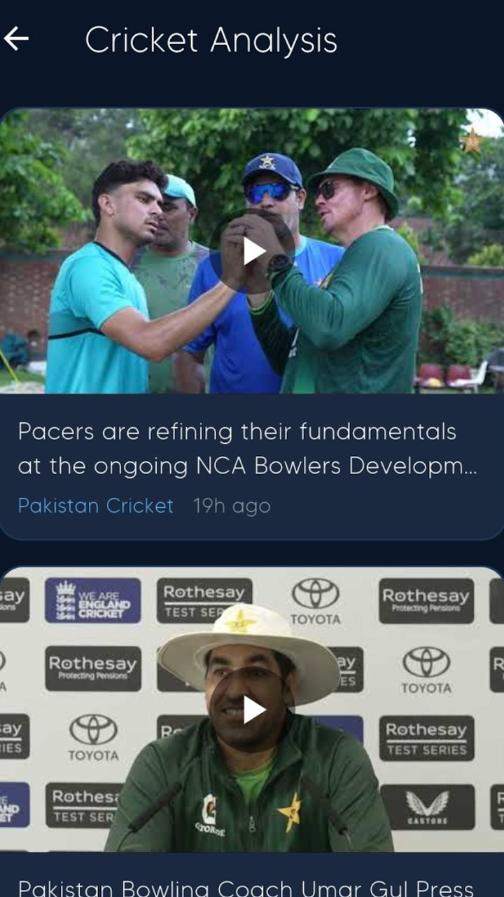 <b>Cricket Analysis</b></td>
</tr>
<tr>
<td align="center" width="33%">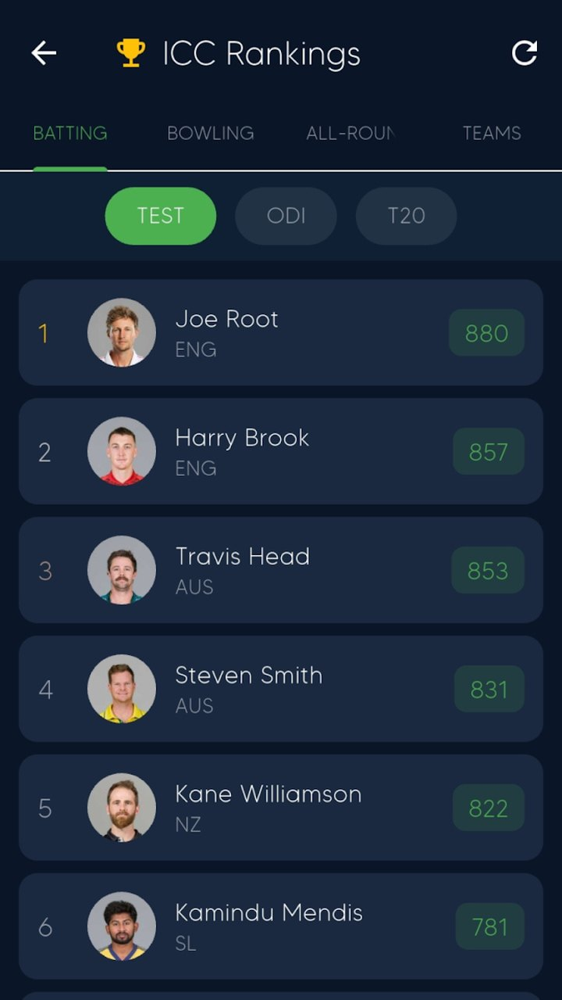 <b>ICC Rankings</b></td>
<td align="center" width="33%">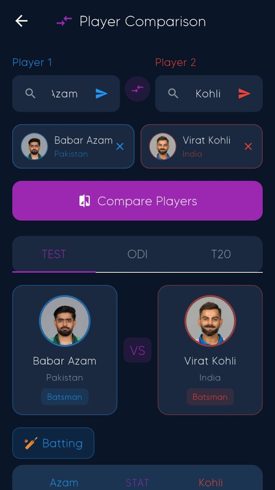 <b>Player Comparison</b></td>
<td align="center" width="33%">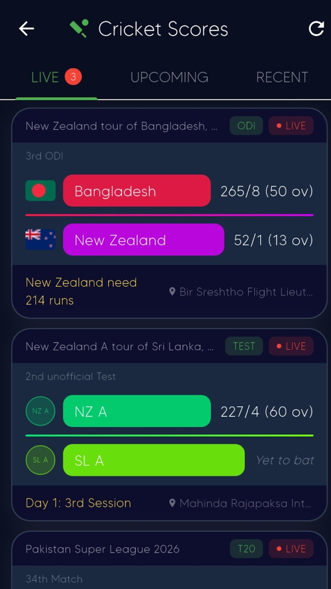 <b>Live Scores</b></td>
</tr>
</table>

<table>
<tr>
<td align="center" width="33%">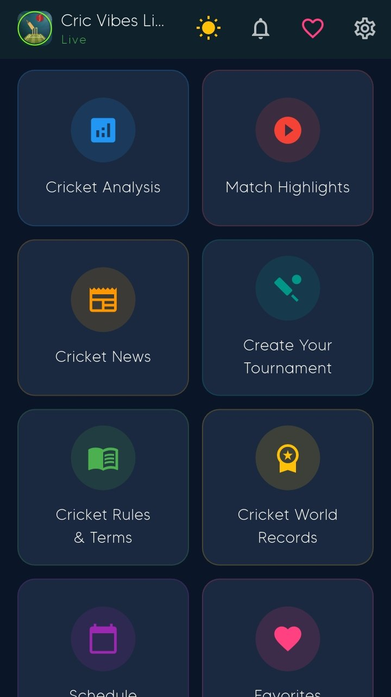 <b>Home</b></td>
<td align="center" width="33%">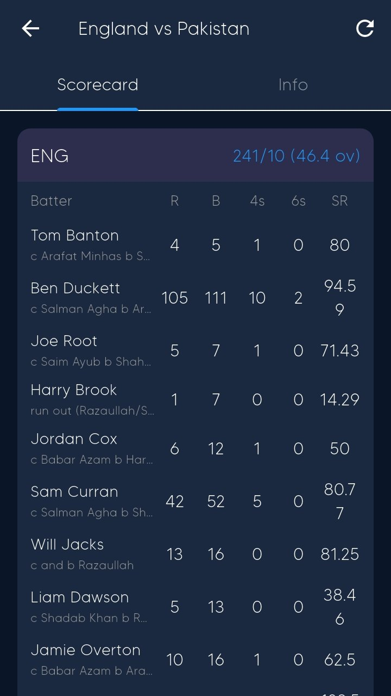 <b>Full Scorecard</b></td>
<td align="center" width="33%">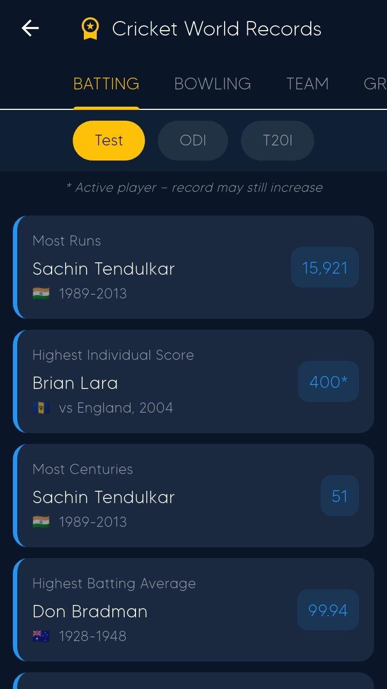 <b>World Records</b></td>
</tr>
<tr>
<td align="center" width="33%">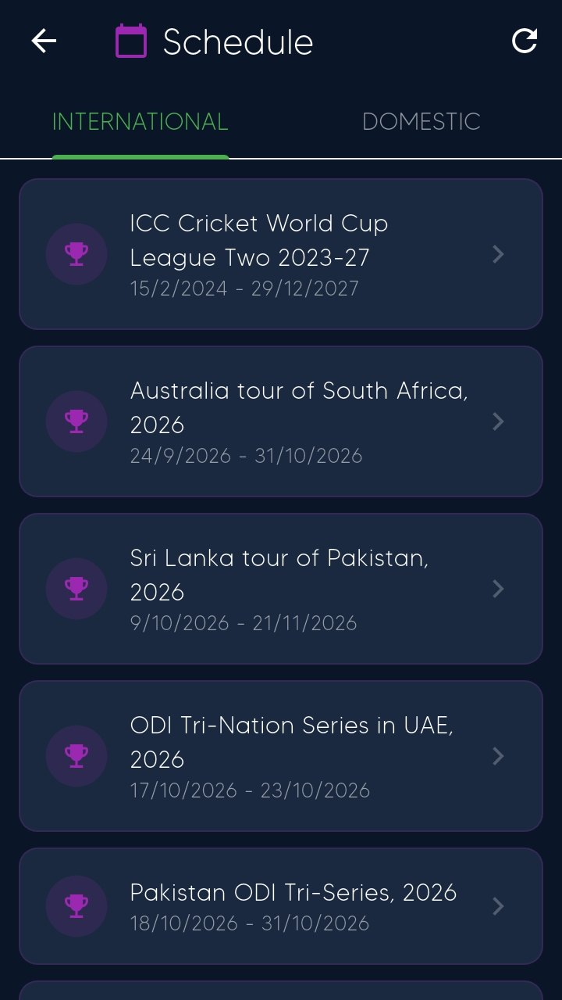 <b>Schedule</b></td>
<td align="center" width="33%">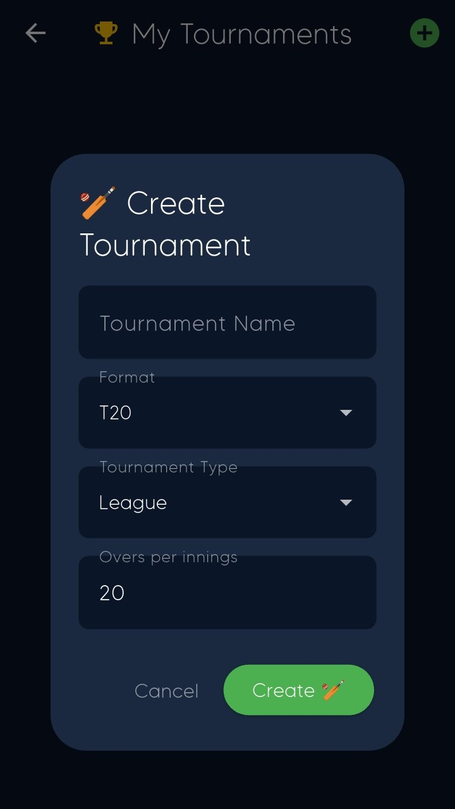 <b>Create Tournament</b></td>
</tr>
</table>

> 📲 More on the [Play Store listing](https://play.google.com/store/apps/details?id=com.niazicricket.app)

## 🚀 What I Learned Building This

This project was my real-world classroom. Key skills gained:

- 📱 **Flutter & Dart** — Widgets, state management, navigation, async programming
- 🔥 **Firebase** — Auth, Firestore rules, Cloud Functions, Secret Manager
- 🌐 **API Integration** — REST APIs, caching strategies, error handling
- 📦 **App Deployment** — Keystore signing, Play Store Console, AAB builds
- 🔔 **Push Notifications** — FCM topic subscriptions, notification backend
- 🧠 **AI-assisted Development** — Debugging with AI tools, code scalability
- 🔧 **Git & GitHub** — Version control, branching, resolving conflicts

## 📲 Download

**✅ Live on Google Play Store — download it today!**

## 👨‍💻 Developer

**Jamshaid Khan Niazi**
BS Computer Science — PIEAS, Islamabad (2029)
🏷️ Founder, Niazi Tech

## ⚠️ Note

This is a showcase repository. The source code is kept private to protect API keys and Firebase configuration. The app is fully functional and available for download on the Google Play Store.

## 📄 License

This project is shared for portfolio and showcase purposes. All rights reserved © Niazi Tech.

**⭐ If you find this project impressive, drop a star!**

*Made with ❤️ and lots of ☕ by Niazi Tech*

